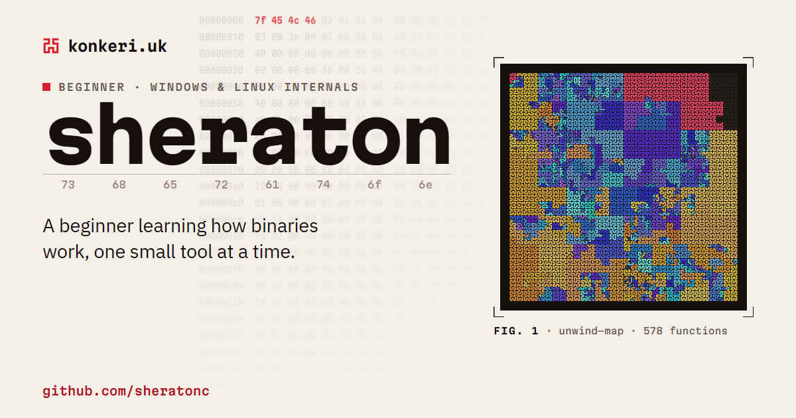

<p align="center"><a href="https://konkeri.uk"></a></p>

# konkeri.uk

The source of [konkeri.uk](https://konkeri.uk), my CV and project index. The page is laid out like an annotated binary: its sections are named like ELF sections (`.text` holds the tools, `.dynamic` the contact links), the table of contents is a `readelf -S` section table with each section's real byte offset in the page, and the header's background is the real first bytes of an ELF file.

- **Live from GitHub.** The Worker reads my repositories and releases from the GitHub API, caches them at the edge for an hour, and falls back to the last complete copy, then to a saved snapshot, if the API is rate-limited.
- **Fig. 1** is a real [unwind-map](https://github.com/sheranton/unwind-map) map of a stripped binary, traced in address order on load. Hovering a trace shows the function it recovered.
- **Page map.** A Hilbert-curve minimap of the page tracks where you are, and the accent colour follows the section you're reading.
- **Two themes,** paper and ink, chosen from the system setting or the toggle.
- **Strict by default.** No frameworks, no client-side JavaScript dependencies, no inline scripts or styles, and a `default-src 'self'` Content Security Policy on every response.

## Layout

| Path | What it is |
| --- | --- |
| `src/index.ts` | The Worker: canonical-host and HTTPS redirects, the cached `/api/github` endpoint, security headers |
| `src/main.ts` | The page script: Fig. 1, the section table, the minimap, the live tool list and release log |
| `src/style.css` | All styles, with one set of colour tokens for both themes |
| `src/outputs.ts` | Real output from each tool, shown in the tool previews |
| `src/github-snapshot.json` | The fallback GitHub data, written by `npm run snapshot` |
| `index.html`, `public/` | The page, the 404 page, Fig. 1, icons and the social card |
| `scripts/` | The snapshot script, and the source of the social card (`og.html`, captured to `public/og.png`) |
| `cloudflare.config.ts` | The Worker's configuration for the `cf` CLI: bindings, assets and custom domains |

## Working on it

```sh
npm install
npm run build      # build the Worker and the static assets
npm run preview    # serve the production build locally
npm run typecheck  # type-check the Worker and the page script
npm run snapshot   # refresh the fallback GitHub data
npm run deploy     # build and deploy to Cloudflare
```

`npm run preview` is the faithful local view: the dev server injects styles inline, which the site's own Content Security Policy blocks.

The Worker reads GitHub with an optional `GITHUB_TOKEN` secret, a read-only token for public repositories that raises the API limit from 60 to 5,000 requests an hour. It's set in the Cloudflare dashboard and declared in `cloudflare.config.ts`, so deploys keep it.

## Licence

All rights reserved. This code is published to be read, not reused; see [LICENSE](LICENSE).
